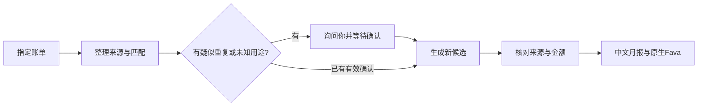

# 家庭记账 Skill

**让 AI 帮你整理账单、找出待核问题，再在自己的浏览器里看收支。**

把已支持的银行、支付宝、微信账单交给本地 Agent：它整理来源、发现疑似重复、询问不确定的用途，生成可复核的 Beancount 候选账本、中文月报和原生 Fava 图表。你负责确认生活用途与来源完整性。

**[免费下载源码 ZIP](https://github.com/enhen3/household-ledger-skill-public/archive/refs/heads/main.zip)** · [开始安装](#开始安装) · [完整演示步骤](references/visual-demo.md) · [支持范围](#支持范围)

作者 **Soren** · 预览版 `0.3.0-preview.20261028.6` · 自有内容 **GPL-2.0-only**

## 结果长什么样

[](https://raw.githubusercontent.com/enhen3/household-ledger-skill-public/main/references/images/fava-income-statement.jpg)

这是**实际运行的原生 Fava 页面截图**，使用随包生成的虚构账单；点击图片可放大。画面保留“只读候选、非正式”标识，没有真实财务资料。[截图来源与口径](references/images/README.md)

这份演示有16笔资金交易、2笔支付佐证和1行重复导出。用途未确认时，**5724元已分类净支出不包含暂挂的320元**；人确认“生日礼物，仅本笔”后，净支出变为6044元，待确认从1变为0。Fava中工资显示-12000是贷方符号，经济含义是收入12000元；不是负工资。

你会拿到：

| 产物 | 用来做什么 |
| --- | --- |
| 原始文件与来源记录 | 保留文件哈希、来源行及关联，能回看这笔钱从哪里来 |
| 待复核清单与确认回执 | 看清疑似重复、未知用途和缺少材料；记录本次确认的范围 |
| Beancount候选账本 | 检查账务结构；生成候选，不自动覆盖正式账本 |
| 中文月报（Markdown / JSON） | 查看期间、分类、净收支、覆盖笔数及待核项 |
| 本机浏览器Fava图表 | 查看损益表、分类和日记账；只读，不替你批准或改账 |

## 它怎样帮你记账



- **避免重复计钱**：银行和支付平台可能记录同一笔付款。系统保留佐证关系；跨导出疑似重叠先询问，不凭“同日同额”直接删行。
- **用途由人确认**：一句“这是生日礼物，只确认本笔”可以补充分类。只有明确要求，才保存适用范围受限的后续规则。
- **缺证据就保留待核**：缺账单、无法解析的交易或未核用途不会被当成零消费或“全部完成”。
- **看图也能追溯**：Fava展示真实候选及来源；侧栏“候选状态与口径”仅是辅助说明，不代替原生图表。

## 开始安装

适合已经会使用 Codex 等本地 Agent、能运行 Python 的用户。需要 **Python 3.11或3.12**，首次安装依赖需要网络；浏览器图表需要允许启动本机服务。源码免费，模型订阅、Agent、API和电脑成本另计。

### 1. 下载整个目录，装到Agent项目里

点击上方下载按钮，或本仓库 **Code → Download ZIP**。解压后进入 `household-ledger-skill-public-main`，确认根目录直接有 `SKILL.md`、`scripts/`、`references/`、`examples/`、`requirements.txt`。

将**整个目录**改名为 `household-ledger-skill` 后放到宿主的项目目录；不要只复制SKILL.md，也不要多套一层解压目录。

| 宿主 | 项目级位置 | 已验证到哪一步 |
| --- | --- | --- |
| Codex | `.agents/skills/household-ledger-skill/` | macOS 27.0.1、Python 3.12.13、CLI 0.163.0：实际发现及显式/自然语言调用通过 |
| Claude Code | `.claude/skills/household-ledger-skill/` | 官方安装规范；本包宿主未实测 |
| WorkBuddy | 技能界面导入本地包，并核对实际解压位置 | 官方规范可适配；本包宿主未实测 |
| Kimi Code | `.kimi-code/skills/household-ledger-skill/`，也支持`.agents/skills` | 官方规范可适配；本包宿主未实测 |

以Codex为例，最终应是 `你的项目/.agents/skills/household-ledger-skill/SKILL.md`。在该项目开始新会话，请它先报告实际加载路径。新项目或新会话不是安全沙盒，也不保证没有既有记忆。

### 2. 对Agent说这段话

> 使用 household-ledger-skill，先报告实际加载的SKILL.md。只用随包虚构数据，先确认Python3.11/3.12、源码目录、独立venv和所有Git工作树之外的新输出目录。说明依赖安装位置与包源后，按README运行doctor和first_run，读回中文月报。不要读取真实账本、其他私人目录或凭据，不推送发布。把实际产物路径和失败原因告诉我。

这条路线会运行**自动合成验收**，其中确认是程序夹具，不是你的真实批准。想录制真人问答时，改走下一节的 prepare 流程，不用first_run的最终结果冒充交互。

自己在macOS/Linux终端执行也可以。把前两行改成自己的绝对路径，选一个尚未使用的venv目录：

```sh
SKILL_DIR="/absolute/path/to/household-ledger-skill"
VENV_DIR="/absolute/path/to/new-ledger-venv"
python3.12 -m venv "$VENV_DIR"
"$VENV_DIR/bin/python" -m pip install -r "$SKILL_DIR/requirements.txt"
"$VENV_DIR/bin/python" "$SKILL_DIR/scripts/review.py" doctor
FIRST_OUTPUT="$(mktemp -d)"
"$VENV_DIR/bin/python" "$SKILL_DIR/scripts/first_run.py" --output "$FIRST_OUTPUT"
printf '月报位置：%s/reports/2001-02.md\n' "$FIRST_OUTPUT"
```

只有Python3.11时，创建venv那行用`python3.11`。每次新终端/工具调用重新设置变量；不用依赖前一次activate或当前工作目录。依赖固定为Beancount3.2.3、pdfplumber0.11.10、openpyxl3.1.5、Fava1.30.16；传递依赖由安装器解析。

### 3. 确认第一次成功

`doctor`应返回`ready=true`；first_run应返回`synthetic_only=true`、`two_runs_byte_identical=true`、`pending=0`、`close_status=complete`、`net_expenses="17.00"`和`production_published=false`。打开上面打印的中文月报。失败时先解决错误，不能把“运行过命令”当成完成。

想看图表，沿用这些变量执行：

```sh
VIEW_DIR="$(mktemp -d)"
"$VENV_DIR/bin/python" "$SKILL_DIR/scripts/visualize.py" prepare \
  --ledger "$FIRST_OUTPUT/candidate/household.beancount" \
  --config "$FIRST_OUTPUT/private/config.json" --month 2001-02 \
  --output "$VIEW_DIR" --synthetic
"$VENV_DIR/bin/python" "$SKILL_DIR/scripts/visualize.py" serve --view "$VIEW_DIR" --port 5231
```

在**同一台电脑**打开启动输出的URL，或`http://127.0.0.1:5231/`，应直接进入原生Fava损益表。此处是17元小样例，与首页截图的6044元完整月份不同。Ctrl-C停止你这次服务；端口已用就换一个高位端口，不停止别人的服务。

[完整安装、缺证据样例、自检与升级说明](references/install.md)

## 真正使用或录制：让人参与确认

第一次试用后，由Agent在你指定的私人目录生成配置，让你确认成员代号、账户和必需来源。只处理你明确选定的文件，不让Agent寻找整台电脑的账单。[首次配置](references/first-use.md)

完整虚构演示可这样开始：

> 用recording_demo prepare在新的空目录生成2001年4月虚构账单。先显示疑似重复的两行，等待我确认；再列用途建议，保留320元待核。禁止self-test、自动填写批准或读取真实数据。

| 真实步骤 | 你做什么 | 可核对结果 |
| --- | --- | --- |
| 输入 | 指定来源，查看疑似重复 | 停在确认点，尚无候选账本 |
| 去重确认 | 确认4月3日486.50元为同一笔 | 保留16笔资金交易；支付佐证不另计支出 |
| 已知用途与来源核对 | 核对15笔建议、退款和独立总额 | 待确认1，净支出5724元；320元暂挂未计入支出 |
| 用途确认 | “320元是生日礼物，仅本笔” | 待确认0、礼物320元、净支出6044元 |
| 看结果 | 查看新快照的损益表、流水、中文月报 | 收入12000元、餐饮672元（已扣退款），保留来源与确认依据 |

确认后生成新快照；刷新旧快照不会自动换数据。`complete`表示该候选与所给来源核对完成，仍不是正式账本发布。详细真人停点、准确命令和重录方式见[完整演示](references/visual-demo.md)。

## 支持范围

| 输入/环境 | 当前边界 |
| --- | --- |
| 银行 | 文档规定字段的CNY CSV；已知招行、可提取文本的PDF版式 |
| 支付宝 / 微信 | 支付宝CSV、微信XLSX；需要核对付款账户映射 |
| 不支持的情况 | 扫描OCR、多币种、复杂分拆、跨月冲销、自动下载账单和生产迁移 |
| 系统 | CLI CI覆盖Ubuntu24.04/macOS14 × Python3.11/3.12；本机macOS27.0.1/Python3.12.13验证。Windows与Python3.13+未测 |
| Agent / RED | CLI通过不等于所有宿主通过。RED仅提供格式适配包，未上架，平台本地服务能力未验证 |

不是任意银行导出文件都能直接使用；异常交易或未知格式应报错，请先查看[输入与操作契约](references/workflow.md)。

## 安全边界与常见问题

**会自动改我的正式账本吗？** 不会。生成的是新候选与报告，正式账本仍走你原有的主写入流程。Fava只读；部分编辑菜单可能可见，但写请求会被拒绝。

**真实账单会留在本机吗？** 脚本在本地解析，但云端Agent读到的文件和工具输出可能发送到模型/日志服务。先用虚构材料；处理真实资料前确认宿主的数据去向。仅在终端运行且不把真实输出发给云端Agent，可避免这一Agent传输路径。[隐私说明](references/privacy.md)

**为什么还有待确认？** 商户名不一定能说明生活用途，缺来源也不能当作零消费。待核是需要补充的信息，不应改状态字段让它“过关”。

**为什么Fava工资是负数？** 收入科目使用贷方符号。截图的-12000对应收入12000；候选没有完整期初余额，不能把资产页当家庭净资产。

**Fava打不开或确认后图没变？** 先看服务是否运行、端口是否冲突；只用localhost。确认后启动新快照，旧视图不会自动切换。云端沙箱的localhost不一定是你电脑的localhost。

**升级会覆盖数据吗？** 请用新源码目录/新venv试跑，再切换项目Skill。保留原配置、账单、规则和回执；不要把数据放进Git仓库或安装包。重录另建目录，不删除旧take。

**需要飞书账号吗？收费吗？** 不需要飞书。源码可免费获取；飞书目前是可另行适配方向，未内置。模型/API等费用由使用者承担，第三方收费服务不代表官方提供或背书。

## 许可证、反馈与详细资料

作者Soren，自有内容采用[GPL-2.0-only](LICENSE.txt)，遵守许可证可使用、修改、再分发及商用。第三方依赖各自许可不变；没有对整个依赖组合作法律保证，详见[版权范围](COPYRIGHT.txt)、[第三方通知](references/third-party-licenses.md)。不捆绑依赖实现或venv。

遇到问题可在[Issues](https://github.com/enhen3/household-ledger-skill-public/issues)提供版本、OS/Python/Agent、命令类别和脱敏错误。**不要上传真实账单、账户、凭据、私人路径或完整含敏感内容的日志。**

[安装细节](references/install.md) · [工作流](references/workflow.md) · [月报口径](references/result-summary.md) · [验收边界](references/acceptance.md) · [版本历史](CHANGELOG.md) · [分发与维护](references/distribution.md)
